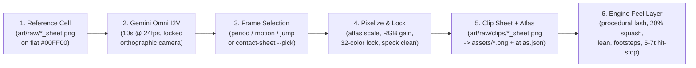

# Character & Sprite Animation Playbook (Omni Video + Engine Feel)

This document captures the end-to-end technique used to upgrade *Gothic Nocturne* from 2–4 frame static pose toggles to fluid 32-bit pixel animations across the hunter, enemies, ally, and bosses — so any new character, enemy, or boss (including new Castle Wing fiends) can be animated the same way in minutes.

---

## Core Principle: Frames Alone Only Get Halfway

Upgrading a 2-frame toggle to an 8-frame sheet without changing **engine timing and secondary motion** only looks *"a bit better"* in play:
1. **Image-to-Video (`omni_1p5`) gives real in-betweens and overlapping action** — arm swing, torso weight shift, cape/hair follow-through, breathing, and multi-phase attack anticipation that independent image-sheet generations cannot keep consistent.
2. **Engine timing & procedural secondary motion make it *feel* alive at 60 fps** — fast travelling weapons (whips, chains, lashes), bold squash & stretch that survives 2×–3× integer scaling, acceleration lean, turn-skid frames, contact-locked SFX/dust, and hit-stop freeze frames.

Always ship **both layers together**.



---

## Layer 1: Video-to-Pixel Sprite Pipeline (`tools/animate_sprites.py`)

### 1. Model Choice
- **Cycles & multi-frame actions (Image-to-Video):** Gemini Omni (`omni_1p5`) via `/google/bin/releases/gemini-agents-generate/generate -prod -timeout=300s -output=<out.mp4> video -model=omni_1p5 -media-uri=<first_frame.png> "<prompt>"` (~35 s per 10 s / 24 fps / 1280×720 clip). *(Note: public Veo 3.1 endpoints were retired in Oct 2026 in favor of Gemini Omni.)*
- **Base reference sprite sheets (Text-to-Image):** `gempix-2-flash-lite-png` following [`STYLE.md`](STYLE.md) on `#00FF00`.

### 2. First-Frame Composition & Prompt Anatomy
1. Crop the character's canonical pose (`idle`, `walk0`, `fly0`, etc.) from `art/raw/<sheet>_sheet.png`.
2. Scale it to `480–560 px` tall and paste onto a `1280×720` flat `#00FF00` canvas with feet on a fixed baseline (`GROUND_Y = 640`).
3. Every I2V prompt combines four constraints:
   - **Style lock:** *"Pixel art sprite animation test footage, 32-bit era console style, crisp hard-edged pixels, limited palette, flat shading. The character stays EXACTLY the same design, proportions, colours and pixel scale as the first frame."*
   - **Camera & key lock:** *"Locked static camera, strict orthographic side view, no zoom, no pan, no camera motion. The background stays a perfectly flat solid pure bright green (#00FF00) with no shadow, no floor, no gradient, no particles, no impact flashes, no sparks, no motion lines, nothing else in frame. No text."*
   - **Single isolated action:** Either a treadmill loop in place (`walk`, `fly`, `float`, `idle`) or **one** complete action starting from the reference pose (`whip`, `jump`, `cast`, `roar`, `lunge`). Keep clips ≤ 10 s so proportions do not drift.
   - **Explicit no-FX suffix on spellcasters/breathers:** Append *"no projectiles, no energy beams, no detached fireballs, no shockwaves"* whenever the engine spawns real `Projectile` entities, otherwise the video model paints giant beam clouds onto the sprite.

### 3. Frame Selection (`--select` vs. `--pick`)
Extract all 240 frames with `ffmpeg` and render a numbered contact sheet (`art/work/clips/<name>/contact.png`):

| Mode | Flag | When to use | Watch out for |
| --- | --- | --- | --- |
| Silhouette autocorrelation | `--select period --count 6..8 --start 30` | Walk, run, fly, float, idle loops | Winged flyers sometimes lock onto a **2-beat** lag (`fly` goes up-down-up-down in 6 frames). Check `frames.png` and override with `--pick` for a single clean beat. |
| Cumulative silhouette delta | `--select motion --count 3..4 --start 12` | Quick enemy attacks that return to stance | If the game **holds the last clip frame** during an active boss telegraph/attack (`roar`, `pounce`, `shell`, `cast`, `surge`, `erupt`), auto-motion often picks the *return-to-idle* at the end! Use `--pick` so the final frame is the **peak held pose**. |
| Feet trajectory | `--select jump` | Vertical jump arc (`crouch,rise0,rise1,apex,fall0,fall1,land0,land1`) | Verify airborne poses are genuinely distinct (extended launch → tuck → apex → legs extending down → deep landing crouch), not 4 identical mid-air tucks. |
| Manual contact-sheet indices | `--pick 22,30,36,55` | Flagship hero moves & boss telegraphs | Always inspect `contact.png` (or a numbered dense strip) and hand-pick exact keyframes when silhouette clarity matters. |

### 4. Pixelization Invariants (Why Video Frames Match Hand-Made Sheets)
Raw video frames look soft, slightly darker, and occasionally contain stray sparks. `animate_sprites.py` normalizes them automatically:
1. **Atlas-calibrated scale (never trust paste size):** Measure the silhouette height in clip frame `0` and set `scale = atlas_ref_height / clip_frame0_height` so clip frames match the legacy sprite to the pixel.
2. **Chroma-key + premultiplied box downscale + hard alpha:** Reuse `process_assets.chroma_key`, `resize_premultiplied`, and `harden_alpha` so edges stay crisp with zero green halo.
3. **8-connected component speck removal (`remove_specks`):** Keep only the largest connected silhouette plus fragments chained within `2 px` (preserving dashed whip tails while stripping floating impact starbursts or dropped weapons), then **re-trim** the bounding box.
4. **Global RGB exposure match + Reference palette lock:** Video codecs darken midtones (~5–15%), which makes nearest-palette snapping jump to muddy shadow colors. Multiply clip RGB by `clip(ref_mean / clip_mean, 0.8, 1.3)` *before* snapping every opaque pixel to the reference sheet's exact 16–32 color palette (`lock_palette`).
5. **Dense-column `ax` & Flyer vs. Walker `ay`:**
   - Compute horizontal center `ax` only across vertical columns whose opaque pixel count is `>= 35%` of body height — thin extended arms, spears, capes, or whips never pull the character's footing sideways.
   - Loop clips pin `ax` to the mean (`--anchor mean`) so treadmill cycles don't wobble horizontally; one-shots use per-frame `hips`.
   - Hovering/flying creatures (`FLYERS` in `animate_cast.py`) use `--anchor-y ground` (fixed baseline from frame 0) so wing downstrokes extend below the body without bouncing the torso up; ground walkers/jumpers use `--anchor-y feet`.

---

## Layer 2: Engine Timing & Procedural Secondary Motion (`src/game/hero_anim.js`)

Frames supply **poses**; engine code supplies **energy and impact**:

1. **Hybrid Painted Body + Procedural Travelling Wave for Fast Weapons (`whipPhase` / `lashPoints` / `drawWhipFrame`)**
   - A whip crack is a travelling wave, not a static horizontal bar.
   - Use Omni frames for body wind-up (`whip0..2`) and slack recoil (`whip6..7`), and hold the extended-arm body frame (`whip3` / `cwhip1`) while drawing an integer-pixel polyline from the scanned hand anchor `(handDx, handDy)`:
     - **`extend` (4 ticks before hitbox):** lash tip flies out `0.22 -> 1.0 × reach` with a 1.5-cycle travelling S-wave.
     - **`crack` (exact tick `whipActive[0]` goes live):** lash snaps taut (`1.04 × reach`) with a white tip cross-flash, ember sparks, `'crack'` synth transient, and `1 px` camera punch.
     - **`live` (remaining active window):** slight overshoot (`1.03 -> 1.00 × reach`) with a fast decaying wave.
     - **`drop` → `slack`:** tip sags under gravity before handing off to painted slack recoil frames.
   - **Speed-scaling alignment rule:** Always compute phase boundaries in **entity seconds** directly from `whipActive[0]`, `whipActive[1]`, and `whipTime` (never pre-divided normalized floats), so attack-speed relics (e.g. Chrono Pendulum `0.75×`) keep the visual crack locked to the exact tick the hitbox activates.
2. **Bold Squash, Stretch & Lean (`src/engine/assets.js` `{sx, sy, skew}`)**
   - Subtle 5–10% transforms vanish at `640×360` upscaled 2×–3×. Use values that read clearly around the bottom-center feet anchor:
     - **Jump launch stretch:** `sx = 0.88, sy = 1.12` decaying over initial upward velocity.
     - **Landing squash:** `sx = 1.22, sy = 0.80` (20% squash) easing out as `(landT / 0.20)^1.6` + landing dust burst.
     - **Acceleration / braking lean:** horizontal skew up to `±0.10 rad` (`player.js`), snapping at rate `40`.
3. **Micro-Transitions & Alive Idles**
   - **Turn-skid (`hero_turn`, 2 frames, `0.08 s`):** trigger when reversing facing while `|vx| > 40`.
   - **Crouch blend (`0.05 s`, 3 ticks):** show half-crouch (`land1`) entering and leaving crouch instead of snapping `64 -> 44 px` in 1 frame.
   - **Deep breathing + Idle fidget (`hero_idle` + `hero_fidget`):** prompt Omni for *exaggerated* chest/shoulder breathing (subtle 1–2 px video motion disappears after downscaling), and play a one-shot fidget clip after `5.0 s` of standing still.
4. **Contact Events & Hit-Stop (`src/game/world.js`)**
   - Fire quiet footstep synth clicks + 2-particle dust puffs on the two walk contact frames (`walk1`, `walk5`).
   - Freeze simulation (`world.hitStop`) for **5 ticks (`0.08 s`)** on enemy hits, **7 ticks (`0.11 s`)** on boss hits, and **2–3 ticks (`0.04 s`)** on breakable blocks (with `2.5 px` camera shake), buffering jump inputs through the freeze so controls never drop.

---

## Layer 3: Zero-State-Machine Cast Layer (`src/game/anim_clips.js` & `tools/animate_cast.py`)

Every enemy, boss, and ally animates through a single draw-time hook in `Enemy.drawSprite()` (`clipFrame(assets, this)`):
- Legacy state machines stay untouched and keep naming `'walk2'`, `'fly0'`, `'windup'`, etc.
- `anim_clips.js` strips trailing digits (`walk2 -> walk`) or consults `FAMILY_ALIASES[sheet]`, checks if `<sheet>_<family>` exists in `atlas.json`, and swaps in the clip frame:
  - **Ground walkers (`px: 8`):** advance by horizontal distance travelled (with a `6 fps` floor while moving slowly; snapping to frame `0` when stopped so feet never moonwalk).
  - **Timed loops (`fly: 12 fps`, `flame: 10 fps`, `float/wave: 7 fps`, `idle: 6 fps`):** advance on the hit-stop-aware world clock with a random per-entity phase offset so groups don't flap in lockstep.
  - **One-shots (`12 fps`, `loop: false`):** start at frame `0` when the family first appears and hold the final frame until the state changes.
- **Overloaded legacy frame names:** When an entity reuses one frame name for two behaviors, resolve it in `FAMILY_ALIASES` with a predicate receiving the entity:
  ```js
  cinderqueen: { idle: (e) => (Math.abs(e.vx || 0) > 1 ? 'walk' : 'idle') },
  archon: {
    roar: (e) => (e._flapping ? 'fly' : 'roar'),
    pounce: (e) => (e._flapping ? 'fly' : 'pounce'),
    shell: (e) => (e.deathT >= 0 ? 'shell_dead' : 'shell'), // falls back to static shell on death
  },
  ```

---

## Step-by-Step Recipe: Animating a New Character or Fiend

1. **Ensure the base sprite sheet exists in `art/raw/` and `assets/atlas.json`:**
   ```bash
   .venv/bin/python tools/process_assets.py --only <sheet>
   ```
2. **Generate clips (single clip or batch via `tools/animate_cast.py`):**
   ```bash
   # Single clip — stop at contact sheet first if it's a complex boss attack:
   .venv/bin/python tools/animate_sprites.py <sheet>_slash --sheet <sheet> --frame idle \
       --action slash --subject "armoured skeleton knight" --stop-after contact
   # Pick exact frames from art/work/clips/<sheet>_slash/contact.png:
   .venv/bin/python tools/animate_sprites.py <sheet>_slash --sheet <sheet> --frame idle \
       --names slash --pick 24,36,48,64 --anchor hips --anchor-y feet

   # Or add the tuple to CAST in tools/animate_cast.py (and FLYERS if airborne) and run:
   .venv/bin/python tools/animate_cast.py --only <sheet> --jobs 4
   ```
3. **Visually inspect `art/work/clips/<name>/frames.png`!** Check for:
   - Detached fireball/beam blobs (re-pick clean frames or re-run with explicit `"no projectiles, no energy beams"`).
   - Double-beat wing loops on flyers (re-pick 1 single wingbeat cycle).
   - One-shots returning to idle on the last frame when the state machine expects to hold the attack/telegraph pose (re-pick so the last frame is the held pose).
4. **Bump `ASSET_VERSION` in `src/engine/constants.js`!**
   - `server.mjs` serves `.png` and `atlas.json` with `Cache-Control: public, max-age=3600` keyed by `?v=${ASSET_VERSION}`. Whenever an existing PNG or `atlas.json` changes, bump `ASSET_VERSION` so browsers never pair fresh frame rects with stale cached sheets.
5. **Verify in the strip harness and headless smoke test:**
   - Hunter tick-by-tick visual strip: `http://localhost:8711/tools/anim_strip.html`
   - Full stage & boss smoke suite: `.venv/bin/python tools/smoke_test.py`

---

## Worked Example: Double-Tap Sprint (`hero_run` loop + `hero_dash` launch)

1. **Loop clip (treadmill prompt, autocorrelation selection):**
   ```bash
   .venv/bin/python tools/animate_sprites.py hero_run --sheet hero --frame walk0 \
       --prompt "The vampire hunter ... performs a smooth, looping treadmill RUN CYCLE in place facing right: \
   a fast athletic sprint with the torso leaning forward, long powerful strides ..., arms pumping ..., \
   a clear airborne moment between strides. Exactly four full stride cycles over the clip ... \
   The character stays centred and does not travel across the screen. No motion lines, no speed streaks, no dust." \
       --stop-after contact
   .venv/bin/python tools/animate_sprites.py hero_run --sheet hero --frame walk0 \
       --names run --select period --count 8 --start 60 --min-lag 14 --max-lag 60 --anchor mean --anchor-y feet --loop
   ```
   (`period 19 frames, correlation 0.58` -> 8 evenly spaced frames of one stride cycle; `--anchor mean` stops treadmill wobble.)
2. **Launch one-shot (`hero_dash`, custom prompt, hand-picked `--pick 42,50,58,70,82,94,106`):** only `dash1` (the explosive lunge) is used as the first `RUN_LAUNCH = 0.10 s` of a sprint.
3. **Engine feel layer** (`src/game/player.js`, `src/game/hero_anim.js`, `src/engine/constants.js`):
   - Input: two `pressed.left/right` edges of the same direction within `PLAYER.runTapWindow` (`0.24 s`) while grounded; the sprint lasts as long as that direction stays held (released, reversed, crouch, stairs, attacks or a hit end it).
   - Physics: `vx` ramps to `PLAYER.runSpeed` (`198 px/s`, relic speed bonuses applied) over `0.14 s`; facing locked while sprinting.
   - Frames: `run0..7` advance by distance (`RUN_PX_PER_FRAME = 11.5 px`, ~17 fps at full speed); contact frames `run1` / `run5` fire footstep clicks + dust.
   - Secondary motion: `+12%` launch stretch relaxing to a steady `4%` forward stretch, `0.13 rad` lean, `'dash'` whoosh and a `1.2 px` camera shake on launch.
   - Network: `runT` / `runFrame` ride along in `buildNetSnapshot()` so remote hunters sprint with the same frames.
4. **Deterministic verification:** `?demo=dash&stage=1&at=12&skip=330&dashfreeze=<t>` double-taps and holds right with no fiends, hit-stopping the sim once the sprint has lasted `t` seconds for headless screenshots.

---

## Troubleshooting & Gotchas Reference

| Symptom | Root cause | Fix |
| --- | --- | --- |
| Omni rejects sprite with *"third-party content"* guardrail | High-res base sprite has photoreal human features or IP-adjacent silhouette (e.g. curved Maleficent-style horns) | Redraw base sheet with `gempix-2-flash-lite-png` in strict side-view 32-bit pixel art using an original visor/faceplate or spire crown. |
| `process_assets.py` warns `expected row counts [4], got [3]` | Diagonal cape/weapon sparks horizontally overlap the adjacent cell on X-axis projection | Separate 2D connected components with `64 px` flat `#00FF00` gaps before running `process_assets.py`. |
| Sprite shifts sideways on attack / death frames | Extended weapon, fire trail, or dropped prop widened the frame bounding box | `crop_frame` trims post-`remove_specks` bounds and centers `ax` on dense vertical columns (`>= 35%` body height); avoid frames with huge detached fire plumes. |
| Flying enemy/boss bobs violently up and down on every flap | Anchored with `--anchor-y feet` so downward wingtips push the body upward | Add the sheet to `FLYERS` (`--anchor-y ground`) so `ay` stays pinned to frame 0's baseline. |
| Browser draws sliced/garbled sprites after repacking a clip | Browser cached the old `<name>.png` under the previous `?v=` query string | Bump `ASSET_VERSION` in `src/engine/constants.js` and hard-refresh. |
